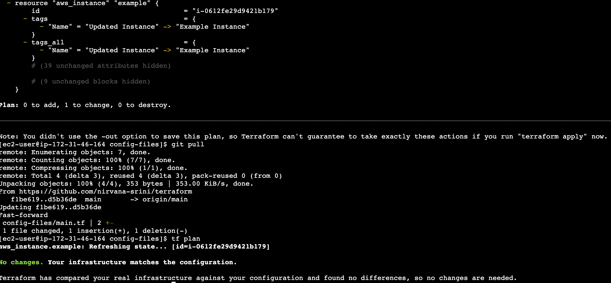
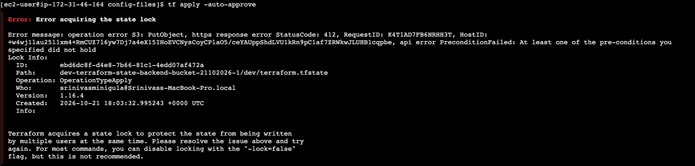
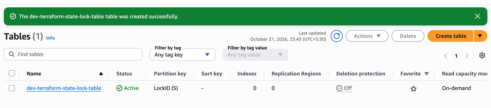
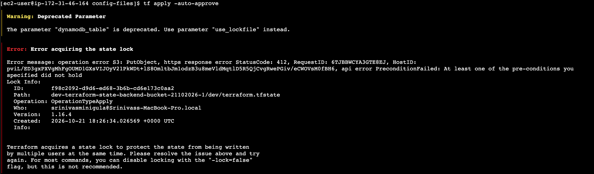
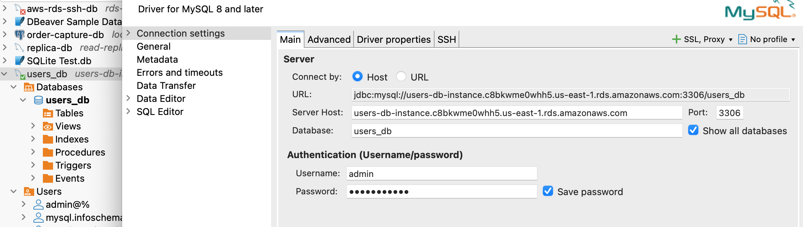
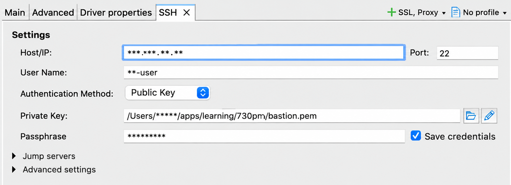

# Terraform

Terraform configuration and setup for multi-cloud infrastructure as code (IaC).

## Configuration files

- `config-files/provider.tf` defines the cloud provider configuration. The example
  configures AWS in `us-east-1`.
- `config-files/main.tf` defines infrastructure resources, including a VPC and
  subnet.
- `config-files/version.tf`where we can define terrafrom and provider version
- `config-files/variables.tf`where we can verbalise the values
- `config-files/terraform.tfvars` where we can pass the values to variables
- `config-files/output.tf`where we can print the values
- `config-files/terraform.tfstate`where we can print the values

## Resource dependencies

Terraform determines the order in which resources are created and destroyed from
their dependencies:

- **Implicit dependency:** Referencing another resource's attribute creates a
  dependency automatically. In `main.tf`, `aws_subnet.dev_subnet` uses
  `aws_vpc.dev.id`, so Terraform creates the VPC before the subnet and destroys
  the subnet before the VPC.
- **Explicit dependency:** Use `depends_on` when one resource relies on another
  for behavior that is not represented by an attribute reference.

The subnet also includes `depends_on = [aws_vpc.dev]` as an explicit dependency
example. It is redundant because `vpc_id` already references the VPC; in normal
configurations, prefer the implicit dependency and reserve `depends_on` for
dependencies Terraform cannot infer.

# Variables

No hard coded values in the resources configuration file.

# Commands

`tf init`initialises all plugins and packages from terraform repository

`tf plan`show preview of resources creating

`tf apply -auto-approve`create resources in aws need to configure the aws credentials for this command to run.

`alias tf="terraform"`

# terraform.tfstate

When terraform state file is not there first time it will create infrastructure resources on aws and creates a state file in the local

For next requests it first verifies the state file whether it is change or add request.

Changes will be always from local to dev direction not from remote to code direction

For example some one changed a dev tagged instance on remote with test again the test will be modified to dev. 1 to change.

If the state file is changed no code changed code and remote are in sync when tf plan it says no change but tf apply will refresh the state to remote state.

## Drift on Ec2 user:



### Error in aquiring the lock

Whiel performing the tf apply from different users at the same time by adding the use_lockfile true option alias tf="terraform"



## Dynamo DB Table Lock



## Errror Message



## generate bastion key pair for ssh

`ssh-keygen -t ed25519 -f ~/.ssh/bastion-key -C "aws-bastion`

Two files are created:

| File                                    | Purpose                                                                            |
| --------------------------------------- | ---------------------------------------------------------------------------------- |
| `<span>~/.ssh/bastion-key</span>`     | Privatekey—keep it secret                                                         |
| `<span>~/.ssh/bastion-key.pub</span>` | Publickey—registered with AWS<br />`file(pathexpand("~/.ssh/bastion-key.pub"))` |

Terraform will read the `<span>.pub</span>` file. Never upload your private key to AWS or commit it to Git.

### To coneect to bastion

`ssh -i ~/.ssh/bastion-key ec2-user@<IP-Address>`

## Only target resource

Create only given target resource with out distrubing all other resource changes.

`tf plan  -target=aws_s3_bucket.custom_bucket`

`tf apply  -target=aws_s3_bucket.custom_bucket -auto-approve`

## DB RDS instances primary and replica

Able to connect to the RDS DB using the bastion as jump server.



Need to provide the bastion key with proper permission to folder and key file.



## Modules

Resusable resource teplate

Define the resources templates in the module using variables.

Ensure No hard coded values in module resource definitions

Call module from various env directories with env psecific values

Each env has its own state and varaible value in its directory its a way to main env specific infra.

### Terraform provided modules

Do not need to write any modules reuse standard modules provided by terraform

They can be direclty used or can also be forked and customised for your use case.

Resource bolcks with no hadcoding teplate is a module.

S3 example

Url to find: [registry.terraform.io/modules/terraform-aws-modules/s3-bucket/aws/latest](https://registry.terraform.io/modules/terraform-aws-modules/s3-bucket/aws/latest)

```Python
module "s3_bucket" {
  source = "terraform-aws-modules/s3-bucket/aws"
  bucket = "my-s3-bucket"
  acl    = "private"

  control_object_ownership = true
  object_ownership         = "ObjectWriter"

  versioning = {
    enabled = true
  }
}
```

  Source view:

[github.com/terraform-aws-modules/terraform-aws-s3-bucket](https://github.com/terraform-aws-modules/terraform-aws-s3-bucket)


## Dependency Block

With out explicitly defing the dependency blocks creation and deletion order may be inconsistent.

### With out dependnecy block

Though we mentioned the s3 resource block in the first in the `main.tf` file it is creating the VPC resource fist.

```Shell
aws_vpc.example: Creating...
aws_s3_bucket.example: Creating...
aws_vpc.example: Creation complete after 4s [id=vpc-04f44fb5fcab5b6b6]
aws_s3_bucket.example: Creation complete after 7s [id=my-example-bucket-26-10-2026]
```
